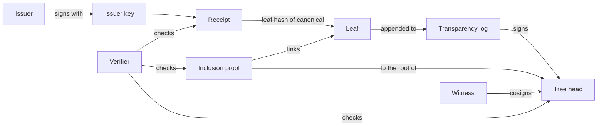

# Ontology and schemas: implementation plan

> **For agentic workers:** use superpowers:subagent-driven-development (recommended) or superpowers:executing-plans to carry out this plan task by task. Steps use checkboxes (`- [ ]`).

**Goal:** add `docs/ontology.md` (every term defined once, with its relations and its RFC 9943 equivalent) and a JSON Schema for each wire object, and make CI fail when a conformance fixture stops fitting them.

**Architecture:** seven schema files in `schemas/` share three definitions (hash, count, v2 signature) through `defs.schema.json`. `schemas/test_schemas.py`, a pytest module, checks each schema against the draft 2020-12 meta-schema, every fixture against `fixture.schema.json`, every fixture's wire object against its schema (accepted fixtures must fit; fixtures that break an encoding rule must not), and three examples. The existing Python CI job runs it.

**Tech stack:** JSON Schema draft 2020-12; Python 3.12, pytest, `jsonschema` 4.26.0 with `referencing`, hash-pinned in `.github/tools/python-ci/requirements.txt`.

**Design:** `docs/design/2026-10-23-ontology-and-proof-explorer.md`, Part 1.

**Prototype:** every file below was run against the 23 fixtures on `main` at `e40e687`: 57 tests passed, ruff check and ruff format clean.

---

## Conventions for every task

- Work in a branch off `main`: `git checkout main && git pull && git checkout -b feat/ontology-and-schemas`.
- git and gh need the Bash sandbox off. If the Write and Edit tools fail on a security-guidance hook error, write files with a heredoc or a short Python script.
- Commit with this identity; no global git identity is set:

```bash
export GIT_COMMITTER_NAME='Christiaan de Wet' GIT_COMMITTER_EMAIL='259622211+christiaan839-beep@users.noreply.github.com'
A='Christiaan de Wet <259622211+christiaan839-beep@users.noreply.github.com>'
git commit --author="$A" -m "<subject>" -m "<body>" -m "Co-Authored-By: Claude Opus 5.5 <noreply@anthropic.com>"
```

- A Python virtualenv with the CI tools (`$VENV` below):

```bash
VENV=$(mktemp -d)/venv && /opt/homebrew/bin/python3.12 -m venv $VENV
$VENV/bin/pip install --require-hashes --no-deps -r .github/tools/python-ci/requirements.txt
```

---

### Task 1: add jsonschema to the hash-pinned CI tools

**Files:**
- Modify: `.github/tools/python-ci/requirements.in` (add one line)
- Regenerate: `.github/tools/python-ci/requirements.txt`

- [ ] **Step 1:** append `jsonschema` to `.github/tools/python-ci/requirements.in`, after `ruff==0.17.0`.
- [ ] **Step 2:** regenerate the hashes, with packages limited to those at least 14 days old (replace the date with today minus 14 days):

```bash
cd .github/tools/python-ci
uv pip compile --generate-hashes --python-version 3.12 --exclude-newer 2026-10-09 -o requirements.txt requirements.in
grep -E '^(jsonschema|referencing|rpds-py|attrs|jsonschema-specifications)==' requirements.txt
```

Expected (with 2026-10-09): `attrs==26.1.0`, `jsonschema==4.26.0`, `jsonschema-specifications==2025.9.1`, `referencing==0.37.0`, `rpds-py==2026.9.1`.

- [ ] **Step 3:** install into `$VENV` with `--require-hashes` (the command above) and confirm `$VENV/bin/python -c "import jsonschema, referencing"` exits 0.
- [ ] **Step 4:** commit: `CI tools: add jsonschema, hash-pinned` (body: what it is for).

### Task 2: the schema test, failing first

**Files:**
- Create: `schemas/test_schemas.py`

- [ ] **Step 1:** create `schemas/test_schemas.py`:

```python
"""
Checks the JSON Schemas in schemas/: each is a valid draft 2020-12 schema;
every conformance fixture fits fixture.schema.json; every fixture a
verifier must accept fits the schema for its wire object; and the
fixtures that break an encoding rule (one spelling per hash and
signature, integer indexes) are rejected by the schema too. The schemas
check shape only; signatures and proofs are the verifiers' job.
"""

from __future__ import annotations

import json
from pathlib import Path

import pytest
from jsonschema import Draft202012Validator
from referencing import Registry, Resource

SCHEMAS = Path(__file__).parent
FIXTURES = SCHEMAS.parent / "packages" / "verifiable-receipts" / "conformance" / "fixtures"
EXAMPLES = SCHEMAS / "examples"

# Fixtures whose failure is an encoding rule the schemas state, not a
# signature or proof the schemas cannot check.
REJECTED_BY_SCHEMA = {
    "v2-invalid-bad-base64.json",
    "v2-invalid-crlf-base64.json",
    "v2-invalid-noncanonical-base64.json",
    "v2-invalid-wrong-version.json",
    "inclusion-0x-prefix.json",
    "inclusion-boolean-index.json",
    "inclusion-fractional-index.json",
    "inclusion-oversized-leaf.json",
    "inclusion-uppercase-hex.json",
}

PROOF_FIELDS = ("leafHashHex", "leafIndex", "treeSize", "auditPath", "rootHashHex")


def _load(path: Path) -> object:
    return json.loads(path.read_text(encoding="utf-8"))


def _registry() -> Registry:
    resources = [
        (schema["$id"], Resource.from_contents(schema))
        for schema in (_load(p) for p in sorted(SCHEMAS.glob("*.schema.json")))
    ]
    return Registry().with_resources(resources)


REGISTRY = _registry()


def _validator(name: str) -> Draft202012Validator:
    schema = _load(SCHEMAS / name)
    return Draft202012Validator(schema, registry=REGISTRY)


def _fixture_files() -> list[Path]:
    files = sorted(FIXTURES.glob("*.json"))
    assert files, f"no fixtures in {FIXTURES}"
    return files


@pytest.mark.parametrize("path", sorted(SCHEMAS.glob("*.schema.json")), ids=lambda p: p.name)
def test_schema_is_valid_draft_2020_12(path: Path) -> None:
    Draft202012Validator.check_schema(_load(path))


@pytest.mark.parametrize("path", _fixture_files(), ids=lambda p: p.name)
def test_fixture_fits_the_fixture_schema(path: Path) -> None:
    _validator("fixture.schema.json").validate(_load(path))


@pytest.mark.parametrize("path", _fixture_files(), ids=lambda p: p.name)
def test_wire_object_matches_the_expected_outcome(path: Path) -> None:
    fixture = _load(path)
    assert isinstance(fixture, dict)
    if "receipt" in fixture:
        wire, validator = fixture["receipt"], _validator("receipt.schema.json")
    else:
        wire = {k: fixture[k] for k in PROOF_FIELDS}
        validator = _validator("inclusion-proof.schema.json")
    fits = validator.is_valid(wire)
    if fixture["expected"]["ok"]:
        assert fits, f"{path.name} must be accepted, so its wire object must fit the schema"
    elif path.name in REJECTED_BY_SCHEMA:
        assert not fits, f"{path.name} breaks an encoding rule the schema states"
    else:
        assert fits, f"{path.name} fails a check the schema cannot make, so its shape must fit"


@pytest.mark.parametrize(
    ("example", "schema"),
    [
        ("tree-head.json", "tree-head.schema.json"),
        ("consistency-proof.json", "consistency-proof.schema.json"),
        ("cosignature.json", "cosignature.schema.json"),
    ],
)
def test_example_fits_its_schema(example: str, schema: str) -> None:
    _validator(schema).validate(_load(EXAMPLES / example))


def test_rejected_by_schema_names_real_fixtures() -> None:
    names = {p.name for p in _fixture_files()}
    assert REJECTED_BY_SCHEMA <= names, sorted(REJECTED_BY_SCHEMA - names)
```

- [ ] **Step 2:** run it; it must fail because there are no schemas yet:

```bash
PYTHONPATH=packages/verifiable-receipts-py $VENV/bin/python -m pytest -q schemas
```

Expected: errors, starting with `FileNotFoundError` for `fixture.schema.json` (no `*.schema.json` exists yet).

### Task 3: the schemas and examples

**Files:**
- Create: the seven files in `schemas/` and three in `schemas/examples/`, below.

- [ ] **Step 1:** create the schemas:

`schemas/defs.schema.json`:

```json
{
  "$schema": "https://json-schema.org/draft/2020-12/schema",
  "$id": "https://github.com/christiaan839-beep/verifiable-receipts/blob/main/schemas/defs.schema.json",
  "title": "Shared definitions",
  "description": "Encodings with one valid spelling each (docs/specs/vaos-2.0.md section 7 and docs/specs/transparency-log.md section 3.6).",
  "$defs": {
    "hash": {
      "description": "A SHA-256 hash: 32 bytes as exactly 64 lowercase hex digits.",
      "type": "string",
      "pattern": "^[0-9a-f]{64}$"
    },
    "count": {
      "description": "A leaf index or tree size: an integer from 0 to 2^53 - 1.",
      "type": "integer",
      "minimum": 0,
      "maximum": 9007199254740991
    },
    "v2Signature": {
      "description": "v2= and a 64-byte Ed25519 signature in canonical padded standard base64: 86 characters, the last with zero padding bits, then ==.",
      "type": "string",
      "pattern": "^v2=[A-Za-z0-9+/]{85}[AQgw]==$"
    }
  }
}
```

`schemas/receipt.schema.json`:

```json
{
  "$schema": "https://json-schema.org/draft/2020-12/schema",
  "$id": "https://github.com/christiaan839-beep/verifiable-receipts/blob/main/schemas/receipt.schema.json",
  "title": "Receipt (v2)",
  "description": "An issuer's signed record of an action (a SCITT Signed Statement). The schema checks shape only: a verifier checks the signature, the content hash and that every repeated field equals the same field of the parsed canonical.",
  "type": "object",
  "required": ["canonical", "signature"],
  "properties": {
    "canonical": {
      "description": "The exact UTF-8 text that was signed: a JSON object.",
      "type": "string",
      "minLength": 2
    },
    "contentHash": {
      "description": "SHA-256 of canonical, optionally prefixed with sha256:.",
      "type": ["string", "null"],
      "pattern": "^(sha256:)?[0-9a-f]{64}$"
    },
    "signature": { "$ref": "defs.schema.json#/$defs/v2Signature" }
  }
}
```

`schemas/tree-head.schema.json`:

```json
{
  "$schema": "https://json-schema.org/draft/2020-12/schema",
  "$id": "https://github.com/christiaan839-beep/verifiable-receipts/blob/main/schemas/tree-head.schema.json",
  "title": "Signed tree head",
  "description": "A log's signed statement of its size and root at a time. The signature covers JSON.stringify of logId, rootHash, timestamp, treeSize and v, in that order; canonical, when present, must equal that text.",
  "type": "object",
  "required": ["v", "logId", "treeSize", "rootHash", "timestamp"],
  "properties": {
    "v": { "const": 1 },
    "logId": { "type": "string", "minLength": 1 },
    "treeSize": { "$ref": "defs.schema.json#/$defs/count" },
    "rootHash": { "$ref": "defs.schema.json#/$defs/hash" },
    "timestamp": {
      "description": "As Date.prototype.toISOString writes it.",
      "type": "string",
      "pattern": "^[0-9]{4}-[0-9]{2}-[0-9]{2}T[0-9]{2}:[0-9]{2}:[0-9]{2}\\.[0-9]{3}Z$"
    },
    "signature": { "$ref": "defs.schema.json#/$defs/v2Signature" },
    "canonical": { "type": "string" }
  }
}
```

`schemas/inclusion-proof.schema.json`:

```json
{
  "$schema": "https://json-schema.org/draft/2020-12/schema",
  "$id": "https://github.com/christiaan839-beep/verifiable-receipts/blob/main/schemas/inclusion-proof.schema.json",
  "title": "Inclusion proof",
  "description": "The audit path linking a leaf to a tree head's root (RFC 9162 section 2.1.3). leafIndex must also be less than treeSize, which a schema cannot express; a verifier checks it. Check rootHashHex against a signed tree head, never on its own.",
  "type": "object",
  "required": ["leafHashHex", "leafIndex", "treeSize", "auditPath", "rootHashHex"],
  "properties": {
    "kind": { "const": "inclusion" },
    "logId": { "type": "string", "minLength": 1 },
    "leafHashHex": { "$ref": "defs.schema.json#/$defs/hash" },
    "leafIndex": { "$ref": "defs.schema.json#/$defs/count" },
    "treeSize": { "$ref": "defs.schema.json#/$defs/count", "minimum": 1 },
    "auditPath": { "type": "array", "items": { "$ref": "defs.schema.json#/$defs/hash" }, "maxItems": 106 },
    "rootHashHex": { "$ref": "defs.schema.json#/$defs/hash" }
  }
}
```

`schemas/consistency-proof.schema.json`:

```json
{
  "$schema": "https://json-schema.org/draft/2020-12/schema",
  "$id": "https://github.com/christiaan839-beep/verifiable-receipts/blob/main/schemas/consistency-proof.schema.json",
  "title": "Consistency proof",
  "description": "The hashes showing a tree of newSize leaves extends the tree of oldSize leaves (RFC 9162 section 2.1.4). oldSize must also be at most newSize, which a verifier checks. Check both roots against signed tree heads.",
  "type": "object",
  "required": ["oldSize", "newSize", "oldRootHex", "newRootHex", "proof"],
  "properties": {
    "kind": { "const": "consistency" },
    "logId": { "type": "string", "minLength": 1 },
    "oldSize": { "$ref": "defs.schema.json#/$defs/count" },
    "newSize": { "$ref": "defs.schema.json#/$defs/count" },
    "oldRootHex": { "$ref": "defs.schema.json#/$defs/hash" },
    "newRootHex": { "$ref": "defs.schema.json#/$defs/hash" },
    "proof": { "type": "array", "items": { "$ref": "defs.schema.json#/$defs/hash" }, "maxItems": 106 }
  }
}
```

`schemas/cosignature.schema.json`:

```json
{
  "$schema": "https://json-schema.org/draft/2020-12/schema",
  "$id": "https://github.com/christiaan839-beep/verifiable-receipts/blob/main/schemas/cosignature.schema.json",
  "title": "Cosignature",
  "description": "A witness's signature over a tree head's canonical text. A witness issues one only for a tree head that extends the last one it cosigned.",
  "type": "object",
  "required": ["witnessId", "sthCanonical", "signature"],
  "properties": {
    "witnessId": { "type": "string", "minLength": 1 },
    "sthCanonical": { "type": "string", "minLength": 2 },
    "signature": { "$ref": "defs.schema.json#/$defs/v2Signature" },
    "publicKeyUrl": { "type": "string", "pattern": "^https://" }
  }
}
```

`schemas/fixture.schema.json`:

```json
{
  "$schema": "https://json-schema.org/draft/2020-12/schema",
  "$id": "https://github.com/christiaan839-beep/verifiable-receipts/blob/main/schemas/fixture.schema.json",
  "title": "Conformance fixture",
  "description": "One test vector in packages/verifiable-receipts/conformance/fixtures. Its inputs may be malformed on purpose, so this schema constrains only the fixture's frame; expected.ok says whether every verifier must accept it.",
  "type": "object",
  "required": ["description", "expected"],
  "properties": {
    "description": { "type": "string", "minLength": 1 },
    "expected": {
      "type": "object",
      "required": ["ok"],
      "properties": { "ok": { "type": "boolean" }, "reasonContains": { "type": "string", "minLength": 1 } },
      "additionalProperties": false
    }
  },
  "oneOf": [
    { "required": ["receipt"], "properties": { "receipt": { "type": "object" } } },
    { "required": ["leafHashHex", "leafIndex", "treeSize", "auditPath", "rootHashHex"] }
  ]
}
```

- [ ] **Step 2:** create the examples. The signatures and hashes show the shape only; nothing verifies them.

`schemas/examples/tree-head.json`:

```json
{
  "v": 1,
  "logId": "example-log",
  "treeSize": 2,
  "rootHash": "983cb57c04cddd52634edab38a7bef85708a974f114bbd9aa9ec5d4ce6656b4b",
  "timestamp": "2026-10-23T12:00:00.000Z",
  "signature": "v2=AATu6RejNeHxufR/Jlu5ITwSmElUxyqaU6zZjsWnx0xflfDqx6DrFHBuyuhEhi0qV95O6xnjj9JVyUrR+vl/Ag==",
  "canonical": "{\"logId\":\"example-log\",\"rootHash\":\"983cb57c04cddd52634edab38a7bef85708a974f114bbd9aa9ec5d4ce6656b4b\",\"timestamp\":\"2026-10-23T12:00:00.000Z\",\"treeSize\":2,\"v\":1}"
}
```

`schemas/examples/consistency-proof.json`:

```json
{
  "kind": "consistency",
  "logId": "example-log",
  "oldSize": 1,
  "newSize": 2,
  "oldRootHex": "2a158d8afd48e3f88cb4195dfdb2a9e4817d95fa57fd34440d93f9aae5c4f82b",
  "newRootHex": "983cb57c04cddd52634edab38a7bef85708a974f114bbd9aa9ec5d4ce6656b4b",
  "proof": ["e23537b050e84af2cbaab46f2f83d8d3b5febc8e5ac6200d306284f687d46924"]
}
```

`schemas/examples/cosignature.json`:

```json
{
  "witnessId": "w1",
  "sthCanonical": "{\"logId\":\"example-log\",\"rootHash\":\"983cb57c04cddd52634edab38a7bef85708a974f114bbd9aa9ec5d4ce6656b4b\",\"timestamp\":\"2026-10-23T12:00:00.000Z\",\"treeSize\":2,\"v\":1}",
  "signature": "v2=AATu6RejNeHxufR/Jlu5ITwSmElUxyqaU6zZjsWnx0xflfDqx6DrFHBuyuhEhi0qV95O6xnjj9JVyUrR+vl/Ag==",
  "publicKeyUrl": "https://witness.example/w1.pem"
}
```

- [ ] **Step 3:** run the test:

```bash
PYTHONPATH=packages/verifiable-receipts-py $VENV/bin/python -m pytest -q schemas
$VENV/bin/ruff check schemas && $VENV/bin/ruff format --check schemas
```

Expected: `57 passed`; ruff `All checks passed!` and `1 file already formatted`.

- [ ] **Step 4:** prove the test catches a loosened rule. Change `defs.schema.json`'s hash pattern to `^[0-9a-fA-F]{64}$`, run the test, and confirm `inclusion-uppercase-hex.json` fails (`breaks an encoding rule the schema states`). Then restore the pattern and rerun to `57 passed`.
- [ ] **Step 5:** commit `schemas/`: `JSON Schemas for every wire object, checked against the fixtures` (body: the seven schemas, what the test checks, that schemas check shape and the verifiers decide validity).

### Task 4: run the schema test in CI

**Files:**
- Modify: `.github/workflows/test.yml` (the Python job's pytest step)
- Modify: `CONTRIBUTING.md` (the Python commands)

- [ ] **Step 1:** in `.github/workflows/test.yml`, the Python job's pytest step reads:

```yaml
        run: python -m pytest packages/verifiable-receipts-py/tests packages/verifiable-receipts/conformance/conformance.py
```

Change it to:

```yaml
        run: python -m pytest packages/verifiable-receipts-py/tests packages/verifiable-receipts/conformance/conformance.py schemas
```

- [ ] **Step 2:** in `CONTRIBUTING.md`, append ` schemas` to the same pytest line in the Python block.
- [ ] **Step 3:** run every check:

```bash
uvx zizmor@1.30.1 --persona pedantic --no-online-audits .github/
$VENV/bin/ruff check .
PYTHONPATH=packages/verifiable-receipts-py $VENV/bin/python -m pytest -q packages/verifiable-receipts-py/tests packages/verifiable-receipts/conformance/conformance.py schemas
```

Expected: zizmor `No findings to report`; ruff clean; pytest `157 passed` (76 package, 24 conformance, 57 schema).

- [ ] **Step 4:** commit: `CI: run the schema test with the Python suite`.

### Task 5: the ontology document

**Files:**
- Create: `docs/ontology.md`
- Modify: `README.md` (one sentence linking it, in the section that lists the specs)
- Modify: `packages/verifiable-receipts/SPEC.md` (one sentence linking it, near the top)

- [ ] **Step 1:** create `docs/ontology.md`:

```markdown
# Ontology

The terms this project uses, each defined once, with how they relate and
what the same thing is called in SCITT, the IETF architecture for signed
statements and transparency services (RFC 9943, June 2026; receipts and
proofs in RFC 9942). This project's model is aligned with RFC 9943. Its
encoding is not SCITT's: receipts are JSON signed with Ed25519 (`v2=`) or
Ed25519 and ML-DSA-65 (`v3=`), where SCITT uses COSE and CBOR, so nothing
here complies with RFC 9943 or claims to.

The wire format of each object is in `schemas/` (JSON Schema, draft
2020-12). The schemas check shape; the verifiers decide validity.

## One name to read carefully

In SCITT, a **Receipt** is the transparency service's signed proof that a
statement is in its log. In this project, a **receipt** is the issuer's
signed record of an action, which SCITT calls a **Signed Statement**. The
log's proof is called an **inclusion proof** here, never a receipt.

## The chain of trust



## Protocol terms

| Term | Definition | SCITT (RFC 9943) |
|---|---|---|
| Issuer | The party that signs receipts: a business, or the host acting for it. | Issuer |
| Issuer key | The issuer's Ed25519 key pair, and its ML-DSA-65 key pair for `v3=`. Verifiers pin the public half. | the key behind `iss` |
| Action | What an agent did after the owner approved it. | the event a Statement is about |
| Canonical | The exact UTF-8 text the issuer signed: a JSON object. | Statement |
| Receipt | `canonical`, its `contentHash`, its `signature`, and any repeated fields. Schema: `receipt.schema.json`. | Signed Statement |
| Repeated field | A top-level field beside `canonical` that must equal the same field of the parsed canonical (`docs/specs/vaos-2.0.md` section 7, step 6). | content of the unprotected header, which SCITT does not bind; here it is bound |
| Transparency log | An append-only RFC 9162 Merkle tree whose leaves are receipts. | Transparency Service; Append-only Log |
| Leaf | `SHA-256(0x00 ‖ canonical)`. A canonical submitted twice is one leaf. | an entry in the Verifiable Data Structure |
| Tree head | The log's signed statement of its size and root at a time. Schema: `tree-head.schema.json`. | the Transparency Service's endorsed state |
| Inclusion proof | The audit path linking one leaf to the root of one tree head. Schema: `inclusion-proof.schema.json`. | Receipt, with the inclusion Proof Type (RFC 9942) |
| Consistency proof | The hashes showing a later tree head of a log extends an earlier one. Schema: `consistency-proof.schema.json`. | the consistency Proof Type (RFC 9942) |
| Logged receipt | A receipt with an inclusion proof and the tree head it is checked against. | Transparent Statement |
| Witness | An independent party that cosigns a tree head only if it extends the last tree head it cosigned. | a specialised Auditor |
| Cosignature | A witness's signature over a tree head's canonical text. Schema: `cosignature.schema.json`. | not defined in RFC 9943 |
| Fork | Two different roots for one log at one tree size. | Equivocation |
| Verifier | Software that checks receipts, proofs and cosignatures: the TypeScript, Python and Go libraries, verify-receipts-action, and the proof explorer. | Relying Party |

## Relations

- An Issuer signs a Receipt with an Issuer key.
- A Receipt carries exactly one Canonical. Each of its Repeated fields
  equals the field of the same name in that Canonical.
- A Transparency log holds Leaves in order. Each Leaf is the hash of one
  Receipt's Canonical.
- A Tree head commits to one Transparency log at one size, and that log
  signs it.
- An Inclusion proof links one Leaf to one Tree head. Its root is checked
  against the signed Tree head, never on its own.
- A Consistency proof links an earlier Tree head to a later Tree head of
  the same log.
- A Witness issues Cosignatures over Tree heads, and issues none for a log
  once it has seen a Fork in it.

## Agent terms (sovereign-agents)

These describe where an Action comes from. Only the Receipt crosses from
this side to the protocol side.

| Term | Definition |
|---|---|
| Job | One kind of work an agent does for a business, such as supplier inbox and reorders. |
| Run | One execution of a job, with its own spend budget, ending in a signed run receipt. |
| Staged change | A change the agent proposes; it is never applied by the agent. |
| Approval | The owner's yes or no to a staged change, given outside the model. |
| Cap | A limit checked in code: spend per run and per day, and limits on each change. |
| Applier | The host code that applies an approved change and signs an action receipt. |
| Fence | The marking that keeps third-party text (emails, reviews, order notes) as data in the model's context. |
```

- [ ] **Step 2:** check every claim in it against the code before committing:
  - each schema named in the table exists in `schemas/`;
  - `docs/specs/vaos-2.0.md` section 7 step 6 is the repeated-field rule;
  - the agent terms match `~/Projects/sovereign-agents/README.md` ("How it works" and "What is where").
- [ ] **Step 3:** in `README.md`, where the specs are listed, add: "`docs/ontology.md` defines every term, its relations, and its equivalent in SCITT (RFC 9943)." In `packages/verifiable-receipts/SPEC.md`, under the title, add: "Terms are defined in [`docs/ontology.md`](../../docs/ontology.md)."
- [ ] **Step 4:** render check: open `docs/ontology.md` on the PR branch on GitHub and confirm the Mermaid diagram renders.
- [ ] **Step 5:** commit: `Ontology: every term defined once, with its RFC 9943 equivalent`.

### Task 6: pull request

- [ ] **Step 1:** push the branch and open the PR (`gh pr create --base main`). The body summarises the four commits and the test counts, and ends with `🤖 Generated with [Claude Code](https://claude.com/claude-code)`.
- [ ] **Step 2:** wait for every required check to pass, then merge with a merge commit (`gh pr merge --merge`). Never squash.
