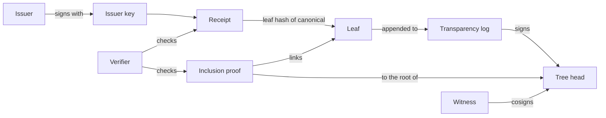

# Ontology

The terms this project uses, each defined once, with how they relate and
what the same thing is called in SCITT, the IETF architecture for signed
statements and transparency services (RFC 9943, June 2026; receipts and
proofs in RFC 9942). This project's model is aligned with RFC 9943. Its
encoding is not SCITT's: receipts are JSON signed with Ed25519 (`v2=`) or
Ed25519 and ML-DSA-65 (`v3=`), where SCITT uses COSE and CBOR.

The wire format of each object is in [`schemas/`](../schemas) (JSON Schema,
draft 2020-12). The schemas check shape; the verifiers decide validity.

## One name to read carefully

In SCITT, a **Receipt** is the transparency service's signed proof of a
property of its log, such as the inclusion of a statement. In this project,
a **receipt** is the issuer's signed record of an action, which SCITT calls
a **Signed Statement**. The log's proof is called an **inclusion proof**
here, never a receipt.

## The chain of trust

## Protocol terms

| Term | Definition | SCITT (RFC 9943) |
|---|---|---|
| Issuer | The party that signs receipts: a business, or the host acting for it. | Issuer |
| Issuer key | The Ed25519 key pair an issuer signs with, and its ML-DSA-65 key pair for `v3=`. The issuer publishes the public half at `/.well-known/sovereign-receipts/` ([VAOS 2.0](specs/vaos-2.0.md) section 6.3, [VAOS 3.0](specs/vaos-3.0.md) section 6.3); whether a verifier trusts that key is its own decision. | none; SCITT names the Issuer with the `iss` claim |
| Action | What a receipt records: something an agent did or produced, such as an applied change, a run, or a Guardian verdict. | none; a Statement is about an Artifact |
| Guardian attestation | The signed result of running Guardian rules over one run's input and output: each rule's verdict (`pass`, `warn` or `block`) and the overall verdict, the worst of them. `verifyGuardianAttestation` checks its canonical, `contentHash` and signature. | none |
| Canonical | The exact UTF-8 text the issuer signed: a JSON object. | Statement (the payload) |
| Receipt | `canonical` and `signature`, usually `contentHash`, and any repeated fields. Schema: [`receipt.schema.json`](../schemas/receipt.schema.json). | Signed Statement |
| Repeated field | A top-level field beside `canonical` that must equal the same field of the parsed canonical ([VAOS 2.0](specs/vaos-2.0.md) section 7, step 6). A consumer reads values from `canonical`; the copy beside it is a convenience. | none; COSE unprotected headers are not covered by the signature, and here every repeated field is |
| Transparency log | An append-only RFC 9162 Merkle tree whose leaves are hashes of receipts' canonical text. | Transparency Service; Append-only Log |
| Leaf | `SHA-256(0x00 ‖ canonical)`. In a log that follows the [transparency log](specs/transparency-log.md) append protocol (section 4), such as receipts-log, a canonical submitted twice is one leaf. The TypeScript `TransparencyLog.append` does not check, and appends a duplicate as a new leaf. | an entry in the Verifiable Data Structure |
| Tree head | The log's statement of its size and root at a time, signed by the log with `v2=` or `v3=`. Schema: [`tree-head.schema.json`](../schemas/tree-head.schema.json). The schema does not require `signature`, because the TypeScript library builds a tree head unsigned for the caller to sign; an unsigned tree head proves nothing. | none as a separate object; a Transparency Service endorses the state of its Verifiable Data Structure |
| Inclusion proof | The audit path linking one leaf to the root of one tree head. Schema: [`inclusion-proof.schema.json`](../schemas/inclusion-proof.schema.json). | Receipt, with the inclusion Proof Type (RFC 9942) |
| Consistency proof | The hashes showing a later tree head of a log extends an earlier one. Schema: [`consistency-proof.schema.json`](../schemas/consistency-proof.schema.json). | Receipt, with a consistency Proof Type (RFC 9942) |
| Logged receipt | A receipt, its inclusion proof and the tree head the proof is checked against. They are three objects with no combined schema; nothing embeds one in another. | Transparent Statement, which embeds the Receipt in the Signed Statement |
| Witness | An independent party that cosigns a tree head only if it extends the last tree head it cosigned ([transparency log](specs/transparency-log.md) section 5). | not defined; the closest is an Auditor |
| Cosignature | A witness's `v2=` signature over a tree head's canonical text. Schema: [`cosignature.schema.json`](../schemas/cosignature.schema.json). The `trs1` threshold envelope also has cosigners; they sign receipts and are unrelated. | not defined |
| Fork | Two different roots for one log at one tree size. | Equivocation |
| Verifier | Software that checks receipts and proofs. The TypeScript library does not check `v2=` receipts. It has `verifyDualSig`, which checks a `v3=` signature with an Ed25519 check the caller supplies; `verifyGuardianAttestation`; `verifyThresholdAttestation`, for `trs1` envelopes; and inclusion and consistency proof verification. The `v2=` receipt check in JavaScript is the repository's conformance verifier, [`verify-v2.mjs`](../packages/verifiable-receipts/conformance/verify-v2.mjs), which the package does not ship. The Python and Go libraries check `v2=` receipts, Guardian attestations and inclusion proofs. No verifier checks a `v3=` receipt's `contentHash` or repeated fields, and none checks the signature on a tree head or a cosignature. | Relying Party |

## Relations

- An Issuer signs a Receipt with an Issuer key.
- A Receipt carries exactly one Canonical. Each of its Repeated fields
  equals the field of the same name in that Canonical.
- A Transparency log holds Leaves in order. Each Leaf is the hash of one
  Receipt's Canonical.
- A Tree head commits to one Transparency log at one size, and that log
  signs it.
- An Inclusion proof links one Leaf to one Tree head. Its root is checked
  against a signed Tree head, never on its own.
- A Consistency proof links an earlier Tree head to a later Tree head of
  the same log.
- A Witness issues Cosignatures over Tree heads. It issues none for a Tree
  head that does not extend its last one, or that shows a different root
  for a size it has already cosigned (a Fork).

## Agent terms (sovereign-agents)

These describe where an Action comes from. Only the Receipt crosses from
this side to the protocol side.

| Term | Definition |
|---|---|
| Job | One kind of work an agent does for a business, such as supplier inbox and reorders. |
| Run | One execution of a job, with its own spend budget, ending in a signed run receipt. |
| Staged change | A change the agent proposes; it is never applied by the agent. |
| Approval | The owner's yes or no to a staged change, given outside the model. |
| Cap | A limit checked in code: spend per run and per day, and limits on each change. |
| Applier | The job's host-side code that applies an approved change through the job's connectors, after the caps are checked again. The kit then signs an action receipt. |
| Fence | The marking that keeps third-party text (emails, stock and supplier records) as data in the model's context. |
